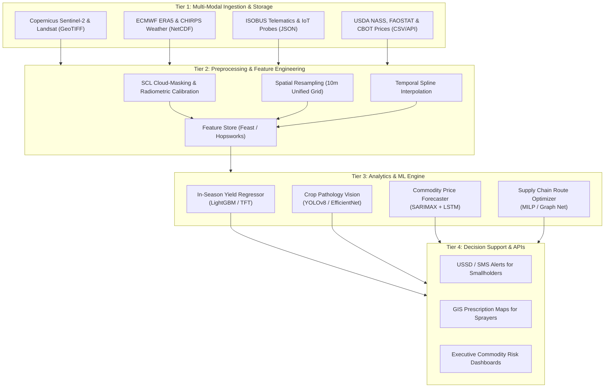

# Agribusiness Market Analysis & Planning
## A Comprehensive Industry Landscape, Stakeholder Matrix, and Conceptual Data Science Framework

**Deliverable Type:** Week 1 Foundational Report & Research Roadmap  
**Domain:** Agribusiness, Agritechnology, Commodity Markets & Agricultural Data Science  
**Generated Document:** [`Agribusiness_Market_Analysis_and_Planning_Report.docx`](file:///c:/Agridatascience%20project/Agribusiness_Market_Analysis_and_Planning_Report.docx)  

---

## 1. Executive Summary

The global agribusiness sector represents a foundational pillar of human survival, economic vitality, and geopolitical stability. Encompassing an expansive global value chain valued in excess of \$3.8 trillion, the industry is responsible for feeding an expanding world population projected to reach 9.8 billion by 2050. To satisfy this burgeoning caloric and nutritional demand, agricultural production must increase by an estimated 60% to 70% from current baselines. However, this production surge must be achieved in an era characterized by acute arable land constraints, freshwater depletion, catastrophic climate volatility, escalating geopolitical friction, and stringent global regulatory decarbonization mandates.

Historically dominated by empirical intuition, localized trial-and-error, and fragmented commodity intermediaries, the agribusiness sector is currently experiencing a historic paradigm shift: the transition toward hyper-precision, data-driven agriculture (AgTech 4.0). This revolution unites ubiquitous Internet of Things (IoT) sensors, multi-spectral satellite remote sensing, automated farm machinery telemetry, genomics, and advanced artificial intelligence. Despite this technological inflection point, agribusiness stakeholders—ranging from resource-constrained smallholders to multi-national grain conglomerates—continue to grapple with persistent structural inefficiencies, severe post-harvest spoilage (averaging 30% to 40% in emerging economies), extreme commodity price elasticity, and asymmetrical information distribution.

> **Core Strategic Purpose:**  
> This foundational report serves as the strategic anchor for the Data Science Virtual Internship. It provides a multi-dimensional examination of the macro agribusiness landscape, decomposes key sub-sectors, evaluates stakeholder dynamics, formulates a 4-tier Key Performance Indicator (KPI) taxonomy, and constructs an end-to-end Conceptual Data Science Framework. This architecture bridges raw agronomic/remote sensing data with advanced predictive machine learning to guide subsequent technical weeks.

The subsequent analytical tasks of this internship will directly leverage the conceptual data pipeline, feature schemas, and empirical research directions synthesized in this report. By harmonizing disparate data domains—such as satellite-derived vegetation indices, gridded reanalysis climatology, soil geochemical metrics, and wholesale commodity futures—data scientists can build resilient, scalable models that optimize farm profitability, mitigate systemic climate risks, and secure global food distribution systems.

---

## 2. Macro Environment & Global Value Chain Architecture

### 2.1 PESTLE Environmental Analysis

| Dimension | Macro-Environmental Factor | Structural Agribusiness Impact |
| :--- | :--- | :--- |
| **Political** | Geopolitical conflicts & trade protectionism (e.g., Black Sea grain disruptions, fertilizer export bans). | Causes sudden commodity supply shortages, drives domestic food sovereignty policies, and triggers rapid price volatility across cereal imports. |
| **Economic** | Inflationary pressure on synthetic inputs, fluctuating energy tariffs, and interest rate hikes. | Compresses operational margins for farmers, elevates credit default risk, and forces consolidation among agricultural retailers and equipment financiers. |
| **Social** | Consumer preference shifts toward organic, clean-label, non-GMO, and carbon-neutral food sources. | Requires farm-to-fork traceability, incentivizes regenerative farming, and reshapes demand for plant-based alternative proteins and functional crops. |
| **Technological** | Convergence of Edge-AI, robotic automation, low-Earth orbit (LEO) satellite constellations, and synthetic biology. | Democratizes real-time field diagnostics, enables variable-rate input application, and enhances crop resilience via targeted genetic editing (CRISPR). |
| **Legal** | Rigorous environmental mandates (e.g., EU Deforestation Regulation [EUDR], SEC Climate Disclosures, pesticide bans). | Imposes mandatory spatial supply chain auditing, penalizes undocumented land conversion, and necessitates verifiable ESG data reporting. |
| **Environmental** | Anthropogenic climate change, mega-droughts, erratic monsoon cycles, and topsoil erosion. | Reduces historical harvest predictability, shifts arable agro-ecological zones poleward, and elevates systemic multi-breadbasket failure risks. |

### 2.2 Deconstructing the Agribusiness Value Chain

The agribusiness value chain is characterized by a high degree of interdependency spanning three distinct stages: Upstream, Midstream, and Downstream.

```mermaid
flowchart LR
    subgraph Upstream["1. Upstream (Inputs & Tech)"]
        direction TB
        U1["Germplasm & Hybrid Seeds\n(Bayer, Corteva, Syngenta)"]
        U2["Crop Nutrition & Biologicals\n(NPK, Microbials, Biostimulants)"]
        U3["Machinery & Telemetry\n(Deere, CNH, ISOBUS Sensors)"]
    end

    subgraph Midstream["2. Midstream (Farming & Aggregation)"]
        direction TB
        M1["Cultivation & Harvesting\n(Smallholders vs. Mega-Farms)"]
        M2["First-Mile Aggregation\n(Co-ops, Grain Elevators)"]
        M3["Cold Chain & Storage\n(Hermetic Silos, Refrigerated Hubs)"]
    end

    subgraph Downstream["3. Downstream (Processing & Retail)"]
        direction TB
        D1["Global Commodity Trading\n(ABCD: ADM, Bunge, Cargill, LDC)"]
        D2["Secondary Food Processing\n(FMCG: Nestle, PepsiCo, Unilever)"]
        D3["Retail, Wholesale & Export\n(Supermarkets, Quick-Commerce)"]
    end

    Upstream -->|"Inputs & Equipment"| Midstream
    Midstream -->|"Raw Commodities"| Downstream
```

#### Upstream Sector (Inputs & Technology)
- **Crop Genetics & Seed Production:** Dominated by consolidated life-science conglomerates investing heavily in germplasm optimization, drought-tolerant hybrid traits, and disease-resistant transgenic cultivars.
- **Crop Nutrition & Protection:** Includes macro-nutrients (Nitrogen via Haber-Bosch, Phosphorus, Potassium - NPK), specialized micro-nutrients, and crop protection chemicals (herbicides, insecticides, fungicides). Rapid expansion in biologicals (microbials, bio-stimulants).
- **Machinery & Hardware:** Global original equipment manufacturers (John Deere, CNH Industrial, AGCO, Kubota) integrating GPS auto-steer, ISOBUS telematics, variable-rate actuators, and autonomous field robotics.
- **Digital Agronomy & Telemetry:** IoT soil moisture probes, weather stations, drone multi-spectral imaging rigs, and farm management software (FMS) capturing granular spatial data at field scale.

#### Midstream Sector (Farming Operations & Primary Consolidation)
- **Farm Enterprise Operations:** Encompasses primary cultivation, planting, crop scouting, irrigation management, and mechanical harvesting. Diverges between large-scale industrial farms (>500 ha) and smallholders (<2 ha).
- **First-Mile Aggregation & Post-Harvest Storage:** Local collection centers, grain elevators, on-farm silo networks, and co-operative hubs. Focuses on drying, moisture stabilization, fumigation, and grading.
- **Cold Chain Infrastructure:** Temperature- and humidity-controlled logistics crucial for perishable horticulture, dairy, and meat. A lack of cold-chain infrastructure causes 30-40% losses in developing markets.

#### Downstream Sector (Processing, Distribution & Consumption)
- **Global Commodity Trading & Crushing:** Dominated by the historic "ABCD" quadrumvirate (ADM, Bunge, Cargill, Louis Dreyfus), managing international bulk grain chartering, oilseed crushing, and global arbitrage.
- **Secondary Food & Industrial Processing:** FMCG corporations (Nestle, PepsiCo, Unilever, Danone) converting raw agricultural commodities into branded foods, animal feed, biofuels, and biochemicals.
- **Wholesale, Retail & Foodservice Distribution:** Supermarket chains, institutional distributors, and quick-commerce platforms enforcing strict quality standards, traceability, and delivery schedules.

---

## 3. Industry Trends, Critical Challenges & Innovation Opportunities

### 3.1 Major Industry Trends
- **Hyperspectral & Satellite Precision Agronomy:** Intra-field variable rate management powered by weekly multi-spectral Earth Observation constellations (Copernicus Sentinel-2, PlanetScope).
- **Autonomous Field Robotics & Edge-AI:** Deployment of autonomous tractors, targeted robotic weeding (e.g., John Deere See & Spray reducing herbicide volume up to 75%), and automated drone spraying swarms.
- **Regenerative Agriculture & Biologicals Transition:** Rapid adoption of conservation tillage, multi-species cover cropping, and bio-fertilizers to restore degraded soil microbiomes and sequester carbon.
- **Agri-FinTech & Parametric Index Insurance:** Alternative digital underwriting based on satellite vegetation health and mobile money histories to provide smallholders with micro-loans and automated drought payouts.
- **Supply Chain Provenance & Traceability:** QR-code serialization and distributed ledger technologies satisfying regulatory mandates (e.g., EU Deforestation Regulation - EUDR).

### 3.2 Critical Industry Challenges

| Core Challenge | Underlying Causal Mechanism | Socio-Economic & Environmental Consequence |
| :--- | :--- | :--- |
| **Post-Harvest Spoilage & Wastage** | Sub-optimal grain storage structures, inadequate hermetic sealing, moisture control failure, severed cold chains. | Loss of 30-40% of harvested food in emerging economies; severe income loss; wasted irrigation water and embedded carbon. |
| **Water Depletion & Salinization** | Inefficient flood irrigation, unmetered groundwater overdraft, inadequate drainage inducing soil salinization. | Depletion of critical aquifers (Ogallala, Indo-Gangetic Basin); desertification of fertile arable lands. |
| **Commodity Price Volatility** | Climate shocks, speculative commodity trading, fragmented spot market information. | Smallholders forced into distress selling at harvest lows; price gouging by middlemen; under-investment in land. |
| **Soil Degradation & Loss of SOM** | Decades of intensive mono-cropping, chemical over-application, neglect of Soil Organic Matter (SOM). | Diminishing marginal crop yield returns per unit of chemical fertilizer; accelerated topsoil erosion. |

### 3.3 High-Value Innovation Opportunities for Data Science

1. **Predictive In-Season Crop Yield Estimation:** Multi-temporal satellite vegetation indices (NDVI, EVI, NDRE) fused with gridded meteorological reanalysis (ERA5 precipitation, vapor pressure deficit) and soil properties to forecast yield 60-90 days prior to harvest.
2. **Real-Time Computer Vision for Crop Diagnostics:** Edge-deployed CNN architectures (YOLOv8, EfficientNet) trained on plant pathology datasets (PlantVillage) allowing smallholders to photograph leaf lesions for immediate disease identification.
3. **Multi-Variate Commodity Price Forecasting:** Hybrid statistical and deep learning models (SARIMAX with exogenous macroeconomic regressors, Prophet, Temporal Fusion Transformers) ingesting climate indices (ENSO, IOD), crop conditions, and port inventories.
4. **Spatial Logistics & Cold-Chain Fleet Optimization:** Mixed-integer linear programming (MILP) and graph neural networks optimizing perishable produce collection routes and cold-chain temperature compliance.

---

## 4. Market Segmentation & Stakeholder Analysis

### 4.1 Market Segmentation Dimensions

| Segmentation Axis | Primary Categories | Key Operational Attributes | Data Science Applicability |
| :--- | :--- | :--- | :--- |
| **Sub-Sector** | • Arable Row Crops • Horticulture • Livestock & Dairy • Aquaculture • Forestry | Varying production cycles, perishability windows, capital intensity, and storage durability. | Spectral index monitoring for row crops; vision-based grading for horticulture; acoustic monitoring in livestock. |
| **Operational Scale** | • Smallholder (<2 ha) • Medium Commercial (2-50 ha) • Industrial Mega-Farms (>50 ha) | Smallholders feature high labor density and low capital; industrial farms exhibit high mechanization and telemetry. | Low-bandwidth mobile advisory for smallholders; complex multi-spectral variable-rate prescription maps for mega-farms. |
| **Geographical & Agro-Ecological** | • Temperate Plains • Tropical Monsoon • Semi-Arid • Mediterranean | Determines soil moisture balance, frost risk, pest pressure, growing degree days, and multi-cropping feasibility. | Localized transfer learning; regional climate-adjusted yield baselines; drought anomaly detection algorithms. |
| **Value Chain Orientation** | • Input Manufacturers • Producers • Aggregators / Co-ops • Processors & Retailers | Disparate profit margins, regulatory exposures, capital turn cycles, and inventory perishability profiles. | Demand forecasting for inputs; production optimization for farms; routing and spoilage reduction for distributors. |

### 4.2 Comprehensive Stakeholder Analysis

| Stakeholder | Power / Interest | Strategic Objective | Critical Pain Point | Data Science Opportunity |
| :--- | :---: | :--- | :--- | :--- |
| **Smallholder Farmers** | Low Power High Interest | Maximize net yield per hectare; minimize debt; ensure food security. | Asymmetrical spot market pricing, weather shocks, lack of working capital. | Hyper-local weather alerts, SMS pest diagnostics, transparent digital market pricing. |
| **Commercial Farm Enterprises** | Medium Power High Interest | Maximize ROIC; optimize input efficiency; automate field labor. | Telematics fragmentation, escalating fertilizer costs, operator shortages. | Variable-rate input prescription maps, automated yield monitor calibration. |
| **Input Manufacturers** | High Power High Interest | Drive seed/chemical sales; forecast regional demand; protect IP. | Stringent regulatory scrutiny, long R&D cycles (8-10 yrs), supply bottlenecks. | Genomic prediction algorithms; regional demand forecasting via satellite planting data. |
| **Grain Traders (ABCD)** | High Power High Interest | Maintain crushing margins; optimize bulk chartering; manage price risk. | Macro supply shocks, port congestion, sudden trade tariff shifts. | Satellite-based pre-harvest global yield modeling, spatial commodity trade tracking. |
| **Crop Insurers & Banks** | High Power Med Interest | Deploy capital safely; reduce NPLs; expand insurance portfolios. | High cost of manual loss adjustments, lack of rural credit bureau data. | Satellite-verified parametric drought payouts, digital credit scoring models. |
| **Government Agencies** | High Power High Interest | Ensure national food security; stabilize food inflation; hit ESG goals. | Delayed census data, fiscal waste in untargeted input subsidies. | National food balance sheet modeling, geospatial disaster damage assessment. |

---

## 5. Key Performance Indicators (KPIs) Taxonomy

| Domain | Key Performance Indicator | Measurement Methodology / Formula | Target / Benchmark Standard |
| :--- | :--- | :--- | :--- |
| **Agronomic** | Yield per Hectare (YPH) | $\text{Clean Harvest Mass (kg)} / \text{Harvested Area (ha)}$ | Corn: 10-12 t/ha US, 2-3 t/ha Sub-Saharan Africa |
| **Agronomic** | Normalized Difference Veg. Index (NDVI) | $(\text{NIR} - \text{Red}) / (\text{NIR} + \text{Red})$ via Satellite / Drone | Dense Healthy Canopy: 0.65 - 0.85; Stressed: < 0.30 |
| **Agronomic** | Water Use Efficiency (WUE) | $\text{Crop Yield (kg/ha)} / \text{Water Consumed (ET in mm)}$ | Maize: 1.5 - 2.5 kg/m³; Wheat: 1.0 - 1.8 kg/m³ |
| **Agronomic** | Nitrogen Use Efficiency (NUE) | $\text{Harvested N in Biomass} / \text{Total N Applied}$ | Global benchmark: >65%; Typical actual: 40-50% |
| **Operational** | Post-Harvest Loss Rate (PHL) | $(\text{Mass Lost} / \text{Total Harvest Mass}) \times 100$ | Developed: < 5-8%; Developing Target: < 15% |
| **Operational** | Cold-Chain Temp Compliance | $(\text{Hours in Spec} / \text{Total Transit Hours}) \times 100$ | Fresh Produce & Perishables: > 99.5% |
| **Operational** | Silo Moisture Equilibrium | Continuous sensor sampling (%) within aeration range | Long-term safe cereal storage: 12.5% - 13.5% |
| **Financial** | Net Margin per Hectare | $(\text{Gross Crop Revenue} - \text{Total Operating Costs}) / \text{ha}$ | Row crops benchmark: > \$250 - \$400/ha net margin |
| **Financial** | Farm-Gate to Retail Spread | $((\text{Retail Price} - \text{Farm-Gate Price}) / \text{Retail Price}) \times 100$ | Grains: 40-60%; Perishables: 60-80% capture |
| **Financial** | Loan Default Rate (NPL) | $(\text{Defaulted Agri-Loan Value} / \text{Total Portfolio}) \times 100$ | Commercial bank target: < 3.5%; Agri: < 5.0% |
| **Sustainability** | Soil Organic Carbon (SOC) | Dry combustion elemental analysis (% C in top 30cm) | Healthy agricultural soil: > 2.0% - 3.5% organic C |
| **Sustainability** | Emissions Intensity per Unit | $\text{Total kg CO}_2\text{-equivalent emitted} / \text{kg produce}$ | Target: 5-7% year-over-year decarbonization |

---

## 6. Conceptual Data Science & Analytics Framework

### 6.1 Architectural Overview: The 4-Tier Pipeline

### 6.2 Data Points & Schema Catalog for Exploration

| Variable Name | Primary Data Source | Spatial / Temporal Res. | Data Type & Format | Analytical Target / Purpose |
| :--- | :--- | :--- | :--- | :--- |
| **Surface Reflectance (B2, B3, B4, B8, B11, B12)** | Copernicus Sentinel-2 (ESA) | 10m - 20m / 5-day revisit | Raster GeoTIFF (Float32) | Calculate vegetation indices (NDVI, NDRE, NDWI); crop canopy vigor. |
| **Precipitation & Cumulative Rainfall** | CHIRPS / ECMWF ERA5-Land | 0.05° (~5km) / Daily | Gridded NetCDF / Zarr | Quantify drought stress, water deficit anomalies, and flood inundation. |
| **Surface Temperature (T2m Min/Max/Mean)** | ECMWF ERA5 / NOAA GFS | 0.1° (~9km) / Hourly - Daily | Gridded NetCDF (Kelvin) | Compute Growing Degree Days (GDD), heat shock degree days, frost exposure. |
| **Soil Volumetric Water Content (0-7cm, 7-28cm)** | NASA SMAP / ERA5-Land | 0.1° (~9km) / Daily | Gridded NetCDF (m³/m³) | Evaluate root-zone soil moisture exhaustion and irrigation requirements. |
| **Soil Geochemical Properties (pH, SOC, Texture)** | ISRIC SoilGrids 250m | 250m / Static baseline | Raster GeoTIFF / CSV | Model baseline soil fertility, cation exchange capacity, yield potential. |
| **Wholesale Commodity Spot & Futures Prices** | CME/CBOT, World Bank, Mandi APIs | Market-level / Daily | Tabular Time-Series (JSON/CSV) | Train multi-variate commodity price forecasting and arbitrage models. |
| **Historical Harvest Yields & Cultivated Area** | USDA NASS, FAOSTAT, National Portals | County / District / Annual | Tabular CSV (Float) | Ground-truth target variable (kg/ha) for supervised yield regression. |

### 6.3 Mathematical & Algorithmic Formulations

#### 1. In-Season Crop Yield Regression Model
Crop yield $Y_i$ for field $i$ at harvest time $T$ is modeled as a function of time-integrated spectral indices, accumulated agro-climatic indices, and baseline soil attributes:

$$Y_i = f\left( \int_{t_0}^{T} \text{NDVI}_i(t) \, dt, \; \text{GDD}_i(T), \; \text{CWD}_i(T), \; \text{SOC}_i, \; \text{pH}_i \right) + \varepsilon_i$$

Where:
- $\text{GDD}_i(T) = \sum_{t=t_0}^{T} \max\left( \frac{T_{\max}(t) + T_{\min}(t)}{2} - T_{\text{base}}, \; 0 \right)$ (Growing Degree Days)
- $\text{CWD}_i(T) = \sum_{t=t_0}^{T} (\text{ET}_0(t) - P(t))$ (Cumulative Crop Water Deficit)
- $\text{SOC}_i, \text{pH}_i$: Soil Organic Carbon and soil reaction from SoilGrids 250m
- $f(\cdot)$ is parameterized via Gradient Boosted Decision Trees (LightGBM) with Bayesian Hyperparameter Optimization.

#### 2. Multi-Variate Commodity Price Forecasting Model
Wholesale spot prices $P_t$ are modeled via a hybrid SARIMAX-LSTM architecture with lagged exogenous drivers:

$$\Phi_P(B^s) \phi_p(B) (1 - B)^d (1 - B^s)^D P_t = \Theta_Q(B^s) \theta_q(B) \varepsilon_t + \sum_{k=1}^K \beta_k X_{k, t-L}$$

Where $X_{k, t-L}$ denotes lagged exogenous regressors including crude oil futures, Oceanic Niño Index (ONI), and USDA WASDE global stocks-to-use ratios.

---

## 7. Data Governance, Quality Assurance & Ethics

- **Cloud-Masking & Reconstruction:** Optical satellite data is screened using the Scene Classification Layer (SCL); missing temporal observations are interpolated via cubic splines or synthetic aperture radar (SAR Sentinel-1) backscatter cross-calibration.
- **Algorithmic Bias & Regional Equity:** Models trained on industrial monocultures (e.g., US Corn Belt) are fine-tuned via localized transfer learning and stratified cross-validation before deployment to smallholder settings.
- **Farmer Data Sovereignty:** Farm parcel boundaries and yield telemetry are anonymized and spatially aggregated to prevent predatory land speculation or exploitative pricing by agricultural monopolies.
- **Explainable Agronomic Advisory:** Black-box neural predictions are augmented with SHAP (SHapley Additive exPlanations) values to verify biological plausibility before providing field recommendations.

---

## 8. Strategic Roadmap for Subsequent Technical Tasks

| Internship Phase | Core Technical Milestone | Key Methodologies & Tools | Target Deliverable |
| :--- | :--- | :--- | :--- |
| **Week 2: Data Acquisition & EDA** | Ingest public crop yield, satellite NDVI, and meteorological datasets; conduct rigorous exploratory data analysis. | Pandas, GeoPandas, Xarray, Copernicus Hub, Seaborn, Matplotlib. | Jupyter Notebook + EDA Summary Report with correlation matrices. |
| **Week 3: Feature Engineering & Preprocessing** | Compute time-series rolling anomalies, vegetation indices, Growing Degree Days, and lag variables; handle spatial autocorrelation. | Scikit-learn, Rasterio, Feast Feature Store, Spatial Lag Models (PySAL). | Processed analytical feature store & engineered tabular dataset. |
| **Week 4: Model Development & Validation** | Train and benchmark baseline vs. advanced models for crop yield prediction and price forecasting; optimize hyper-parameters. | LightGBM, XGBoost, PyTorch (LSTM), Optuna hyperparameter optimization. | Model Evaluation Matrix (RMSE, R², MAPE, MAE) + Cross-Validation curves. |
| **Week 5: Deployment & Decision Support** | Containerize the best-performing model into an interactive inference API and executive dashboard. | FastAPI, Docker, Streamlit / Plotly Dash, RESTful JSON schema. | Interactive Agribusiness Advisory Dashboard & Technical Documentation. |

---

## 9. Conclusion & Actionable Insights

Agribusiness stands at the nexus of the 21st century's most defining global challenges: feeding a growing human population while reversing environmental degradation and adapting to a volatile climate. Solving these challenges cannot rely on incremental manual adjustments or outdated empirical heuristics. The path forward requires rigorous, scalable data science architectures capable of synthesizing high-frequency geospatial telemetry, atmospheric reanalysis, and market signals into actionable intelligence.

By establishing clear market segmentations, decoding stakeholder pain points across the value chain, standardizing a 4-tier KPI taxonomy, and laying out an end-to-end conceptual data science framework, this Week 1 foundation transforms agribusiness from an ambiguous macro domain into a structured, highly tractable analytical problem space. The data points, schemas, and mathematical formulations established herein will serve as the exact technical blueprint for the data ingestion, feature engineering, and predictive modeling tasks in the upcoming phases of this project.

---

## 10. Academic, Government & Industry References

1. **Food and Agriculture Organization (FAO)** (2023). *The State of Food and Agriculture 2023: Revealing the true cost of food to transform agrifood systems.* Rome: FAO Publications. [https://doi.org/10.4060/cc7724en](https://doi.org/10.4060/cc7724en)
2. **United States Department of Agriculture (USDA) ERS** (2023). *Agricultural Productivity in the U.S. / Global Agricultural Productivity Report (GAPS).* Economic Research Service, USDA.
3. **European Space Agency (ESA)** (2021). *Sentinel-2 User Handbook: High-Resolution Optical Earth Observation Mission for Land Monitoring.* Document Ref: GMES-S2-EOPG-TN-13-0001.
4. **World Bank Group** (2021). *What's Cooking: Digital Transformation of the Agrifood System.* Agriculture and Food Series. Washington, DC: World Bank.
5. **Lobell, D. B., et al.** (2013). *The critical role of extreme heat for maize production in the United States.* Nature Climate Change, 3(5), 497-501.
6. **Basso, B., & Antle, J.** (2020). *Digital agriculture to design sustainable agricultural systems.* Nature Sustainability, 3(4), 254-262.
7. **McKinsey & Company** (2022). *Agtech: Breaking our way out of the agricultural productivity plateau.* McKinsey Center for Agricultural Transformation.
8. **Copernicus Climate Change Service (C3S)** (2023). *ERA5: Fifth generation of ECMWF atmospheric reanalyses of the global climate.* ECMWF Climate Data Store.
