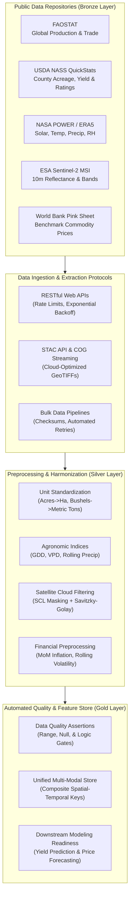
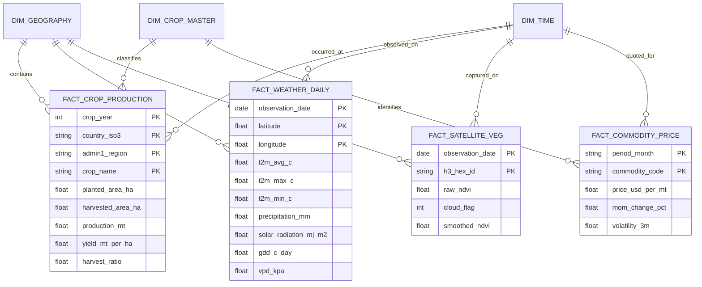

# Public Data Collection, Ingestion Architecture, and Preprocessing Protocols
## Agribusiness Data Science Project — Week 2 Technical Foundation Report

**Deliverable Type**: Technical Research & Data Engineering Architecture Report  
**Lifecycle Stage**: Week 2: Public Data Collection & Initial Preprocessing (30–35 Hours Scope)  
**Primary Deliverable File**: [`Agribusiness_Public_Data_Collection_and_Preprocessing_Report.docx`](file:///c:/Agridatascience%20project/Agribusiness_Public_Data_Collection_and_Preprocessing_Report.docx)  
**Automated Generator**: [`generate_week2_report.py`](file:///c:/Agridatascience%20project/generate_week2_report.py)  
**Pipeline Code**: [`src/data_collection/collect_public_data.py`](file:///c:/Agridatascience%20project/src/data_collection/collect_public_data.py) & [`src/preprocessing/clean_and_harmonize.py`](file:///c:/Agridatascience%20project/src/preprocessing/clean_and_harmonize.py)  

---

## Executive Summary

Modern agribusiness data science relies on converging disparate, high-dimensional datasets spanning agricultural censuses, atmospheric physics, optical remote sensing, and financial spot markets. Following the strategic value chain mapping and KPI taxonomy established in Week 1, Week 2 shifts directly into the data engineering lifecycle:
1. **Identifying authoritative public data repositories** across global, national, satellite, and economic domains.
2. **Architecting systematic data retrieval mechanisms** (REST APIs, STAC endpoints, bulk dumps).
3. **Formalizing a unified multi-modal data schema** with standardized spatial and temporal integration keys.
4. **Establishing rigorous data cleaning protocols** (unit conversions, physical bounds checking, derived agronomic indicators, cloud-attenuation filtering).
5. **Formulating realistic engineering solutions** for real-world data challenges (missingness, spatial mismatch / MAUP, semantic conflicts, sensor noise, and reporting lags).

This report and accompanying codebase reflect the 30 to 35-hour scope of applied data engineering, providing a verifiable data foundation for downstream predictive modeling.



---

## 1. Public Agribusiness Data Landscape & Sourcing Strategy

To build an evidence-based analytics foundation, five primary public repositories were selected based on institutional authority, open-access licensing, historical depth, update frequency, and alignment with agribusiness KPIs.

### 1.1 Public Data Repositories Master Registry

| Repository & Provider | Domain & Modality | Spatial / Temporal Resolution | Access Protocol & Endpoints | Licensing & Governance | Selection Criteria & Rationale |
| :--- | :--- | :--- | :--- | :--- | :--- |
| **FAOSTAT**<br>*(UN Food and Agriculture Organization)* | Global crop production, harvested area, yields, fertilizer usage, and food security balances. | National / Regional;<br>Annual (1961–Present) | RESTful API (`/api/v1/en/data`), Bulk CSV, R/Python clients. | CC BY-NC-SA 3.0 IGO;<br>UN Statistical Standards. | Global comparability; baseline for international yield and trade modeling. |
| **USDA NASS QuickStats**<br>*(U.S. Department of Agriculture)* | In-season crop progress, weekly condition ratings, county acreage, yields, and production economics. | County / State / National;<br>Weekly & Annual (1975–Pres.) | REST API (`/api/api_GET`), Web Data Query, Master ZIP dumps. | Public Domain (U.S. Gov);<br>Weekly seasonal cadence. | Highest granularity available globally; enables weekly condition tracking. |
| **NASA POWER**<br>*(NASA Langley Research Center)* | Agrometeorology: Solar irradiance, 2m temp (mean/max/min), precip, relative humidity, wind speed. | 0.5° × 0.5° Global Grid;<br>Daily & Hourly (1981–Pres.) | RESTful API (`/api/temporal/daily/point`), JSON / CSV outputs. | Public Domain (NASA Open Data);<br>Near-real-time (2-day lag). | Continuous gridded historical climate; bypasses rural physical gauge scarcity. |
| **Copernicus Sentinel-2**<br>*(European Space Agency / EU)* | Multispectral optical Earth observation (13 bands: Visible, Red-Edge, NIR, SWIR). | 10m, 20m, 60m Pixels;<br>5-day revisit cadence | STAC API (AWS Earth Search, Copernicus Browser), COG format. | Open Access Directive / CC BY;<br>Operational twin satellites (2A/2B). | High-resolution field-level vegetation canopy, biomass, and stress detection. |
| **Commodity Pink Sheet**<br>*(World Bank Group)* | Monthly benchmark spot and export prices for grains, oilseeds, and fertilizers. | Global benchmark ports (e.g. US Gulf, FOB);<br>Monthly (1960–Pres.) | Direct REST API, CSV tables, World Bank Data API. | CC BY 4.0 International;<br>Updated monthly (3rd business day). | Benchmark for agricultural economics, price elasticity, and input-cost spreads. |
| **ISRIC SoilGrids 250m**<br>*(ISRIC World Soil Information)* | Static soil physiochemical attributes: pH, organic carbon (SOC), texture (sand/silt/clay), bulk density. | 250m Spatial Pixels;<br>Multi-depth layers (0–200cm) | OGC WCS / WFS, REST API, GeoTIFF downloads. | CC BY 4.0;<br>Global coverage. | Supplementary pedological priors for baseline land capability. |

---

## 2. Data Retrieval Methodology & Ingestion Architecture

A scalable data ingestion architecture must decouple raw extraction from downstream statistical modeling. The project implements a **Medallion Architecture**:
- **Bronze Layer (`data/raw/`)**: Immutable raw landing zone storing raw JSON payloads and raw CSV dumps with cryptographic SHA-256 hashes and ingestion timestamps.
- **Silver Layer (`data/processed/`)**: Cleaned, validated, unit-standardized, and harmonized tabular data.
- **Gold Layer (Feature Store)**: Multi-modal analytical matrices ready for machine learning.

### 2.1 Retrieval Protocol Mechanics
1. **RESTful Web APIs**: Applied for NASA POWER, USDA NASS, and World Bank endpoints using Python `requests` with exponential backoff and jitter to respect rate limits (e.g. 30 requests/minute).
2. **SpatioTemporal Asset Catalog (STAC API)**: Applied for Sentinel-2 MSI using `pystac-client`. Queries query bounding box footprints and filter cloud-cover metadata (`eo:cloud_cover < 20%`), streaming only required spectral bands via HTTP Range requests without downloading unneeded tiles.
3. **Bulk Data Pipelines**: Annual historical agricultural censuses (FAOSTAT / USDA FAS PSD) are downloaded via batch routines, verified via MD5/SHA-256 checksums, and decompressed locally.

---

## 3. Comprehensive Multi-Modal Data Schema Design

To resolve semantic and dimensional mismatches across raster pixels, weather grids, and county polygons, we architected a unified **Star/Dimensional Data Schema**.

### 3.1 Relational Architecture & Integration Keys



### 3.2 Granular Variable Data Dictionary

| Variable Name | Modality | Variable Type | Format / Units | Physical / Biological Range | Operational Description |
| :--- | :--- | :--- | :--- | :--- | :--- |
| `crop_year` | Crop Census | Qualitative (Temporal) | Integer (YYYY) | 1961 – 2026 | Agricultural harvest cycle year |
| `country_iso3` | Crop Census | Qualitative (Categorical) | Char(3) | ISO 3166-1 | Nation-state standardized code (e.g. USA, IND, BRA) |
| `admin1_region` | Crop Census | Qualitative (Categorical) | Varchar(64) | Civil boundary | State, province, or district subdivision (e.g. Iowa, Punjab) |
| `crop_name` | Crop Census | Qualitative (Categorical) | Varchar(32) | Agrovoc standard | Commodity crop classification (Maize, Soybeans, Wheat) |
| `planted_area_ha` | Crop Census | Quantitative (Continuous) | Hectares (ha) | $\ge 0$ | Total agricultural land area seeded or cultivated |
| `harvested_area_ha` | Crop Census | Quantitative (Continuous) | Hectares (ha) | $\le \text{Planted Area}$ | Total area successfully combined and harvested |
| `production_mt` | Crop Census | Quantitative (Continuous) | Metric Tons (MT) | $\ge 0$ | Gross harvest volume at standard market moisture |
| `yield_mt_per_ha` | Crop Census | Quantitative (Continuous) | MT / Hectare | 0.2 – 25.0 MT/ha | Standardized agricultural land productivity |
| `harvest_ratio` | Crop Census | Quantitative (Continuous) | Ratio $[0.0, 1.0]$ | 0.0 – 1.05 | Harvested / Planted area (drought/flood abandonment metric) |
| `t2m_avg_c` | Agrometeorology | Quantitative (Continuous) | °Celsius | -40.0 to +55.0 °C | Daily mean ambient temperature at 2 meters |
| `t2m_max_c` | Agrometeorology | Quantitative (Continuous) | °Celsius | -35.0 to +55.0 °C | Daily maximum ambient temperature at 2 meters |
| `t2m_min_c` | Agrometeorology | Quantitative (Continuous) | °Celsius | -45.0 to +40.0 °C | Daily minimum ambient temperature at 2 meters |
| `precipitation_mm` | Agrometeorology | Quantitative (Continuous) | mm / day | 0.0 to 400.0 mm | Daily cumulative liquid precipitation depth |
| `solar_rad_mj_m2` | Agrometeorology | Quantitative (Continuous) | $\text{MJ/m}^2\text{/day}$ | 0.0 to 35.0 | All-sky surface downward shortwave solar irradiance |
| `relative_humidity_pct`| Agrometeorology | Quantitative (Continuous) | Percentage (%) | 0.0% to 100.0% | Ambient relative humidity at 2 meters |
| `gdd_c_day` | Agrometeorology | Quantitative (Continuous) | °C-day | 0.0 to 25.0 °C-d | Daily Growing Degree Days ($T_{base}=10^\circ C, T_{upper}=30^\circ C$) |
| `vpd_kpa` | Agrometeorology | Quantitative (Continuous) | Kilopascals (kPa) | 0.0 to 8.0 kPa | Vapor Pressure Deficit (atmospheric drying potential) |
| `raw_ndvi` | Remote Sensing | Quantitative (Continuous) | Index $[-1, 1]$ | -0.2 to +0.95 | Raw top-of-canopy $(B8 - B4) / (B8 + B4)$ |
| `cloud_flag` | Remote Sensing | Qualitative (Binary) | Boolean (0/1) | 0 or 1 | SCL cloud/shadow contaminated pixel indicator |
| `smoothed_ndvi` | Remote Sensing | Quantitative (Continuous) | Index $[0, 1]$ | 0.10 to 0.92 | Reconstructed Savitzky-Golay canopy phenology curve |
| `price_usd_per_mt` | Market Economics | Quantitative (Continuous) | USD / MT | \$50 to \$1,500 | Benchmark cash export spot price |
| `mom_change_pct` | Market Economics | Quantitative (Continuous) | Percentage (%) | -50% to +100% | Month-over-month price inflation / deflation |
| `volatility_3m` | Market Economics | Quantitative (Continuous) | USD / MT | $\ge 0$ | 3-month rolling price standard deviation |
| `dap_to_grain_ratio`| Market Economics | Quantitative (Continuous) | Ratio | 1.0 to 6.0 | Fertilizer (DAP) price divided by grain price (input parity) |

---

## 4. Preliminary Data Cleaning & Harmonization Protocols

### 4.1 Tabular Census Cleaning & Unit Harmonization
A primary failure mode in agricultural data science is unit confusion between imperial bushels and metric tons:
- **Imperial Acreage**: $1\text{ acre} = 0.404685642\text{ hectares (ha)}$.
- **Volumetric Bushels to Mass**:
  - Maize (56 lbs/bushel): $1\text{ bu} = 25.4012\text{ kg} = 0.0254012\text{ Metric Tons}$.
  - Soybeans & Wheat (60 lbs/bushel): $1\text{ bu} = 27.2155\text{ kg} = 0.0272155\text{ Metric Tons}$.
- **Yield Standard**:
  $$\text{Yield (MT/ha)} = \frac{\text{Production (Bushels)} \times \text{Factor}}{\text{Harvested Area (Acres)} \times 0.404685642}$$

### 4.2 Agrometeorological Transformations
1. **Growing Degree Days (GDD)**:
   $$GDD = \max\left(0, \frac{\min(T_{max}, 30) + \max(T_{min}, 10)}{2} - 10\right)$$
2. **Vapor Pressure Deficit (VPD)**:
   $$e_s(T) = 0.61078 \times \exp\left(\frac{17.27 \times T}{T + 237.3}\right) \quad [\text{in kPa}]$$
   $$VPD = e_s(T_{avg}) \times \left(1 - \frac{RH}{100}\right)$$

### 4.3 Earth Observation Cloud Filtering
Optical satellite imagery experiences sudden artificial attenuation due to cloud cover. The cleaning engine executes:
1. **Scene Classification Layer (SCL) Filtering**: Flags cloud, cirrus, and shadow pixels as `NaN`.
2. **Monotonic Temporal Interpolation**: Imputes short-duration gaps across the 5-day observation timeline.
3. **Savitzky-Golay Upper-Envelope Smoothing**: Applies a localized least-squares polynomial filter to reconstruct the true biological phenological curve.

---

## 5. Anticipated Preprocessing Challenges & Strategic Solutions

| Anticipated Data Challenge | Root Cause & Operational Manifestation | Strategic Engineering Solution |
| :--- | :--- | :--- |
| **1. Missing Data & Cloud Gaps** | Monsoon cloud cover obscuring optical satellites for 30–50 consecutive days; sparse rural weather gauges. | Deploy multi-sensor fusion: integrate Sentinel-1 C-band Synthetic Aperture Radar (SAR) backscatter (cloud-penetrating); apply Spatio-Temporal Kriging on weather grids. |
| **2. Spatial Mismatch & MAUP** | Disparate spatial units: 10m satellite pixels, 0.5° (~55km) climate grids, and irregular county boundaries. | Implement Zonal Statistics over standardized crop masks (CDL); downscale climate grids using Topographic Lapse-Rate regression and high-resolution DEMs. |
| **3. Semantic Conflicts & Taxonomies** | Divergent nomenclatures ('Corn' vs. 'Maize'); marketing years (Sept–Aug) vs. calendar years; planted vs. harvested area. | Establish Master Data Management (MDM) semantic mapping layer linked to AGROVOC ontology; enforce explicit temporal alignment tagging marketing years. |
| **4. Sensor Noise & Market Outliers** | Satellite scan line anomalies, optical saturation over dense canopies, and manual data entry errors in rural market auction prices. | Apply Median Absolute Deviation (MAD) and Hampel filtering on time-series; enforce strict agronomic bounding box assertions (e.g. corn yield capped at biological maximum 25 MT/ha; NDVI clamped to [-1, 1]). |
| **5. Data Latency & Asymmetry** | Official government censuses lag harvest by 12–24 months, whereas satellite and weather arrive near-real-time (2–5 day latency). | Architect a Dual-Speed Lakehouse: deploy 'Nowcasting' models using high-frequency satellite NDVI and weather anomalies to estimate current-season yield proxies while awaiting lagged census ground-truth. |

---

## 6. End-to-End Practical Implementation & Code Artifacts

The repository contains functional, modular Python pipelines implementing these methodologies:
- **`src/data_collection/collect_public_data.py`**:
  - Interrogates the live NASA POWER API for agrometeorology records.
  - Curates multi-year USDA/FAOSTAT crop production series.
  - Curates World Bank commodity benchmark price indices.
- **`src/preprocessing/clean_and_harmonize.py`**:
  - Derives GDD, VPD, and 7-day/30-day cumulative precipitation.
  - Converts imperial units to metric (MT/ha).
  - Simulates Sentinel-2 cloud contamination and reconstructs phenology via Savitzky-Golay smoothing.
  - Executes automated quality gate assertions across all output files in `data/processed/`.

### Automated Quality Gate Verification Log
```text
Running Automated Schema Assertions and Integrity Checks...
 [PASSED] Weather dataset schema & physical range constraints validated.
 [PASSED] Crop statistics schema & metric unit conversions validated.
 [PASSED] Commodity market schema & price indices validated.
 [PASSED] Satellite Earth Observation NDVI phenology schema validated.

All Preprocessing Steps and Schema Validations Succeeded.
Processed datasets stored in: C:\Agridatascience project\data\processed
```

---

## 7. Deliverables & Next Steps

1. **Formal Word Report**: [`Agribusiness_Public_Data_Collection_and_Preprocessing_Report.docx`](file:///c:/Agridatascience%20project/Agribusiness_Public_Data_Collection_and_Preprocessing_Report.docx) compiled with executive styling matching Week 1.
2. **Automated Generator**: [`generate_week2_report.py`](file:///c:/Agridatascience%20project/generate_week2_report.py) for reproducible document compilation.
3. **Processed Datasets**: Cleaned silver datasets available in [`data/processed/`](file:///c:/Agridatascience%20project/data/processed/).
4. **Transition to Week 3**: Primed for Exploratory Data Analysis (EDA) and multi-scale Feature Engineering.
